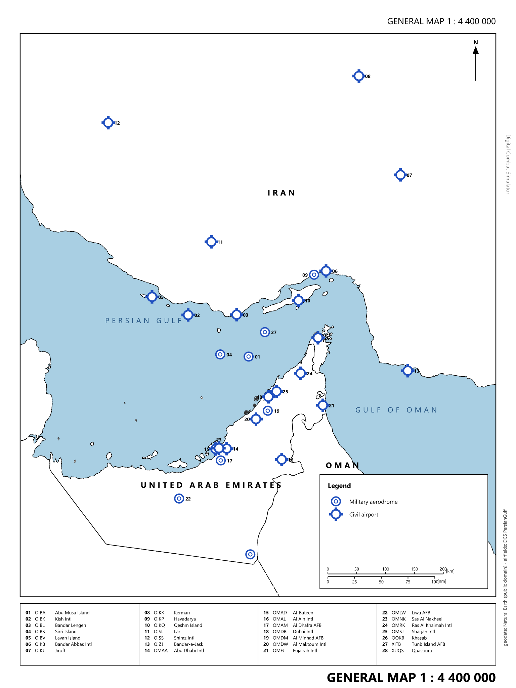

# Kneeboard charts for DCS: Persian Gulf

[← All maps](../README.md)

**English** | [Deutsch](README.de.md)

These are aerodrome charts (GND) and parking position charts (PAR) for every airfield with a paved runway of 1000 m or more on the DCS World map **Persian Gulf**, in Iran, the United Arab Emirates and Oman. Grass strips are not included. The style follows the official DCS charts for the Caucasus map.

> Unofficial charts, not made by Eagle Dynamics. For simulation only, **not for real-world navigation**.

## Folders

| Folder | Content |
|---|---|
| `png/` | Charts as images (1536 × 2048 pixels), e.g. for the kneeboard |
| `svg/` | The same charts as vector graphics, scalable without loss |

## File names

`NN_TYPE_CODE_Name[ - Second name][_Pn]`

| Part | Meaning |
|---|---|
| `NN` | Number of the airfield. All airfields are sorted alphabetically by their code, as on the DCS charts. |
| `TYPE` | `GND`: aerodrome chart. `PAR`: aircraft parking positions. |
| `CODE` | ICAO code or substitute code (see below) |
| `Name` | Name of the airfield as used in DCS |
| `Second name` | Current name, if it differs from the DCS name, e.g. `Al Maktoum Intl - Dubai World Central` |
| `_Pn` | Sheet n, when an airfield has several sheets: P1 is the aerodrome chart, the parking positions follow. Airfields with very many holding positions have their list on a sheet of its own, P2 (`HOLD POSITIONS`) |

At the top of every sheet is the reference for the chart binder, e.g. `GND 12 · P2/4` (ground charts, airfield 12, sheet 2 of 4).

## General map

`00_01_General_Map` shows all airfields with number and symbol, with the list of all airfields below the map. The map is based on Natural Earth (public domain).

## Codes

- **ICAO codes** for all airfields that have one (`OI..` Iran, `OM..` United Arab Emirates, `OO..` Oman). DCS itself uses most of them as radio callsigns.
- **`X…`**: airfields without any known code get an **invented** one: `X`, a country letter (`I` Iran, `U` United Arab Emirates) and two letters of the name, e.g. **XITB** = Tunb Island AFB.

## Aerodrome chart (GND)

- Runways with usable length (from the DCS runway lights) and width, designators
- **Magnetic courses:** the magnetic variation is computed for each airfield with the geomagnetic model that DCS itself uses. The reference date is 1 June 2020, the default date of a new DCS mission on this map. The north arrow shows true north (TN), magnetic north (MN) and the variation, e.g. `VAR 2.2° E (2020)`. In missions with a different date, the variation differs slightly.
- Taxiways with their letters (from the DCS taxiway signs)
- Holding positions `P1`, `P2` … with coordinates (from the holding signs), as on the DCS charts
- Tables: ILS, ARP, elevation, scale, TORA/TODA/ASDA/LDA, radio frequencies, navaids

## Parking positions (PAR)

- Every parking position carries **exactly the number that the DCS Mission Editor shows**. Runway start positions are not drawn.
- **Display:** each parking position is just its number, right at the position. In rows, the number is turned across the row so that neighbouring numbers do not run into each other. Where DCS gives a number twice (a DCS data error), it appears twice on the chart too.
- **Suitability:** for every ramp, the table at the bottom of the sheet lists (checked in the Mission Editor):
  - **AIRCRAFT:** all positions aircraft can use, i.e. normal stands plus shelters and hangars,
  - **HELICOPTER:** all positions helicopters can use, i.e. normal stands plus helicopter stands.

  Normal stands suit both and therefore appear in both columns.
- **Ramps:** Parking positions close to each other form a ramp. Each ramp is named by its compass direction from the centre of the airfield, e.g. `RAMP NORTH`.
  - If several ramps share a direction, the name gets finer (`RAMP NORTH-EAST`) or a number (`RAMP WEST 1`, `RAMP WEST 2`).
  - These names are **invented**; DCS itself does not use them. They are meant for communication between ATC and pilots, e.g. "taxi to ramp north, stand 21".
- **Detail sheets:** If a ramp is too dense for legible labels, it gets an enlarged detail sheet. The overview refers to it ("see P3").
- At the bottom of the sheet is a table of all ramps with their parking positions, together with radio, ARP, elevation and scale.

## Airfields

[Airfields by code](airfields_by_code.md) · [Airfields by name](airfields_by_name.md)

28 airfields, 73 sheets.

