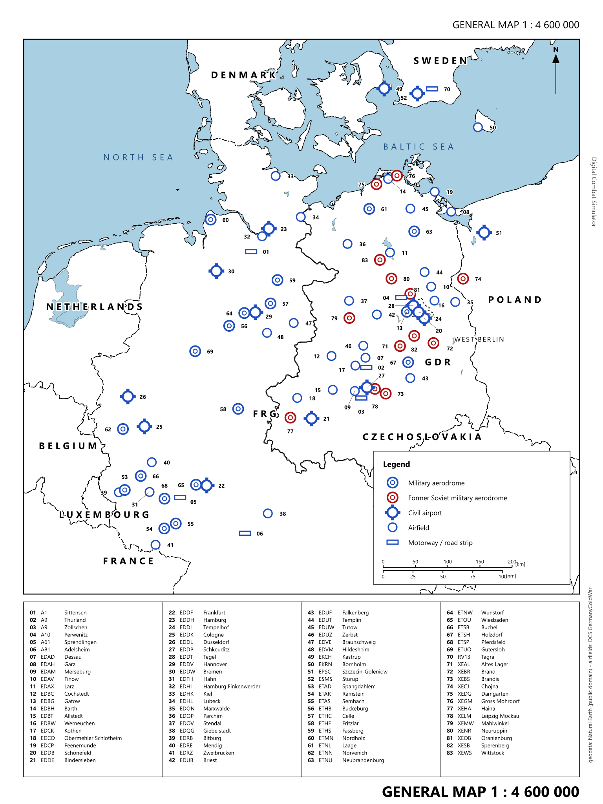
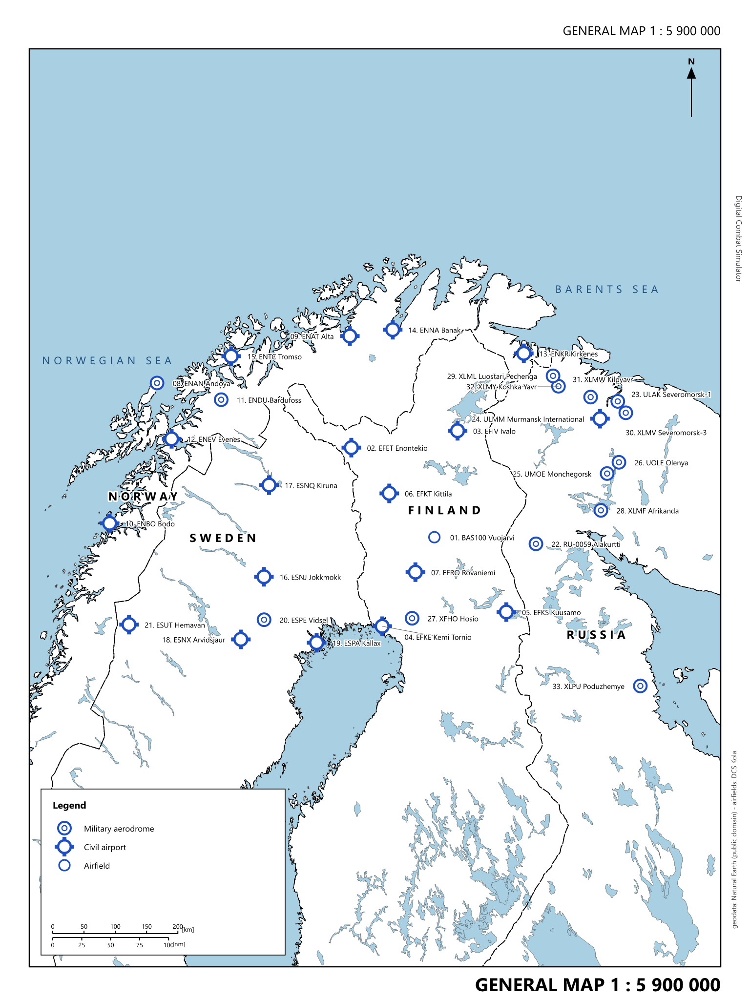
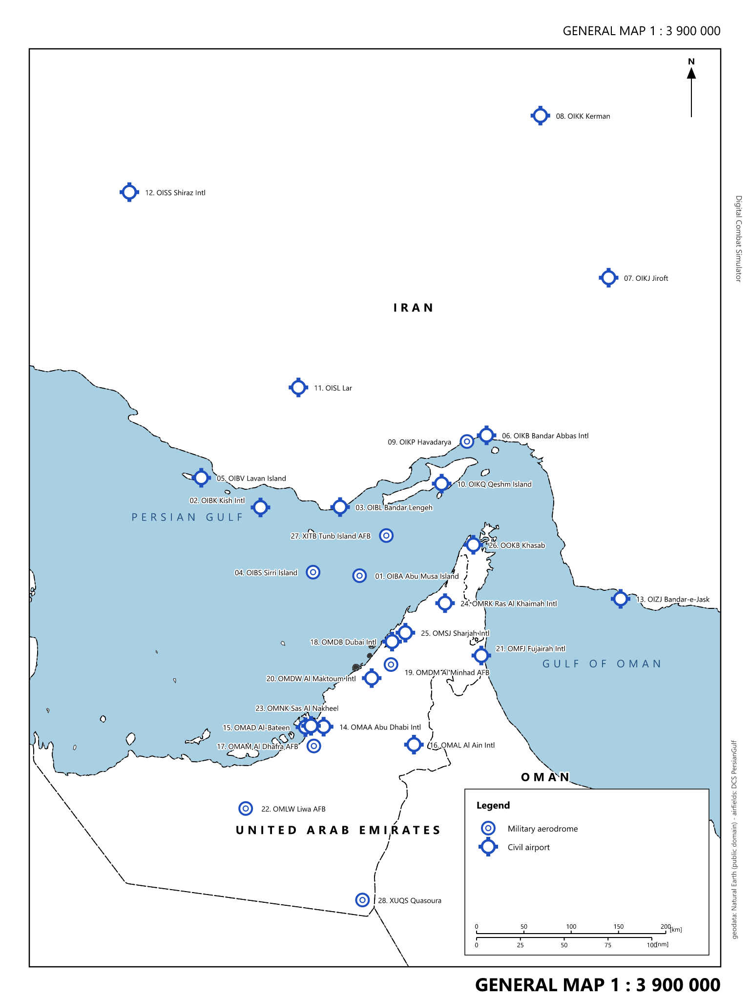
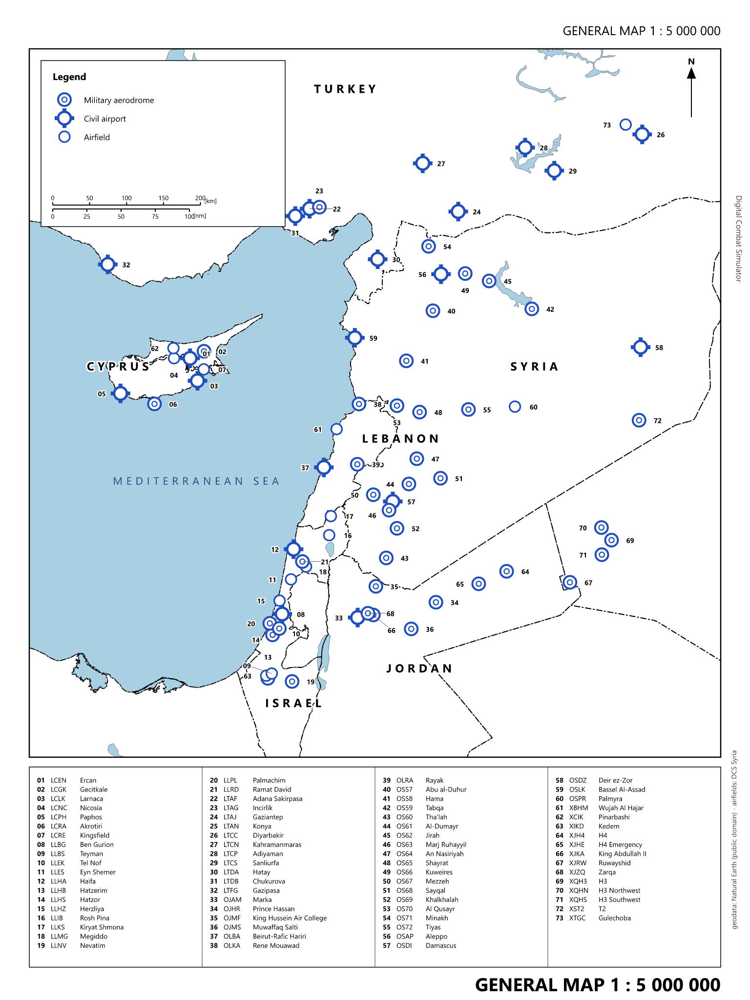

# DCS Aerodrome Charts

[English](README.md) | **Deutsch**

Flugplatzkarten (GND) und Parkpositionskarten (PAR) für die Flugplätze der DCS-World-Karten, im Stil der offiziellen DCS-Karten. Jede Karte hat einen eigenen Ordner mit PNG- und SVG-Dateien, einer Übersichtskarte und Tabellen aller Flugplätze.

> Inoffizielle Karten, nicht von Eagle Dynamics. Nur für die Simulation, **nicht für die reale Navigation**.

## Karten

| Karte | Flugplätze | Blätter | Übersicht | Download |
|---|---|---|---|---|
| [Germany Cold War](GermanyColdWar/README.de.md) | 83 | 209 |  | [GermanyColdWar.zip](https://github.com/sivar2311/DCS-Aerodrome-Charts/releases/latest/download/GermanyColdWar.zip) |
| [Kola](Kola/README.de.md) | 33 | 80 |  | [Kola.zip](https://github.com/sivar2311/DCS-Aerodrome-Charts/releases/latest/download/Kola.zip) |
| [Persian Gulf](PersianGulf/README.de.md) | 28 | 73 |  | [PersianGulf.zip](https://github.com/sivar2311/DCS-Aerodrome-Charts/releases/latest/download/PersianGulf.zip) |
| [Syria](Syria/README.de.md) | 73 | 203 |  | [Syria.zip](https://github.com/sivar2311/DCS-Aerodrome-Charts/releases/latest/download/Syria.zip) |

## Änderungen

Was sich an welcher Karte geändert hat: [CHANGELOG.md](CHANGELOG.md), Details im Changelog der jeweiligen Karte.

## Download

Jedes [Release](https://github.com/sivar2311/DCS-Aerodrome-Charts/releases/latest) enthält je Karte eine ZIP-Datei mit allen PNG-Blättern, fertig für das Kneeboard. Die SVG-Dateien liegen in den Kartenordnern dieses Repositorys.

## Fehler gefunden?

Diese Karten werden automatisch erzeugt. Handänderungen an den Kartendateien würden beim nächsten Lauf überschrieben. Fehler deshalb bitte als [Issue](https://github.com/sivar2311/DCS-Aerodrome-Charts/issues/new/choose) melden: Karte, Flugplatz, Blatt und was falsch ist, am besten mit Screenshot. Korrekturen an den README-Texten sind als Pull Request willkommen.

## Lizenz

Die Karten stehen unter [CC BY 4.0](https://creativecommons.org/licenses/by/4.0/deed.de) (© sivar2311, https://github.com/sivar2311/DCS-Aerodrome-Charts). Die Lizenz umfasst nur den eigenen Beitrag des Autors; Rechte Dritter bleiben unberührt. DCS World ist eine Marke der Eagle Dynamics SA; dieses Projekt steht in keiner Verbindung zu Eagle Dynamics. Übersichtskarten auf Basis von [Natural Earth](https://www.naturalearthdata.com/) (Public Domain). Nur für die Simulation, nicht für die reale Navigation. Ohne Gewähr.
