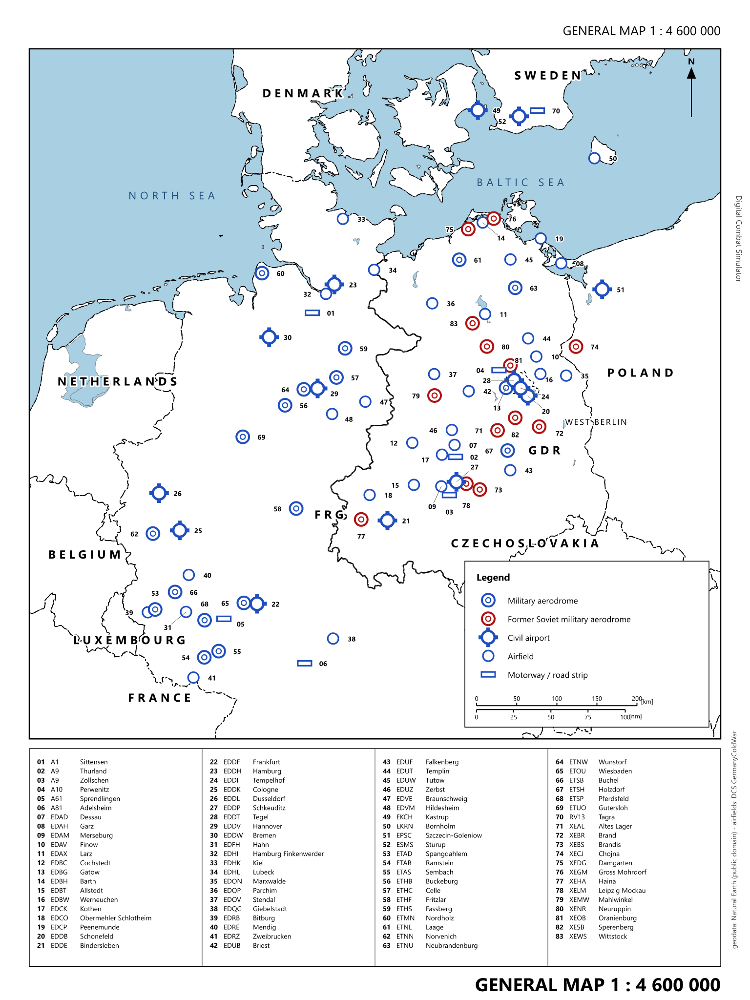
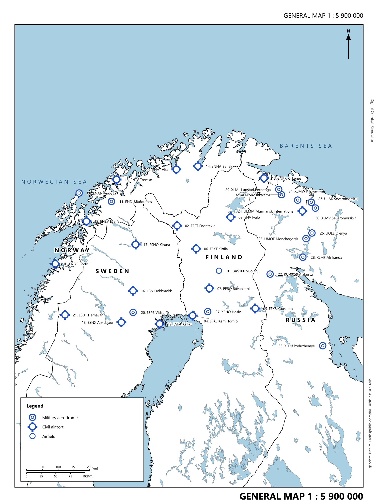
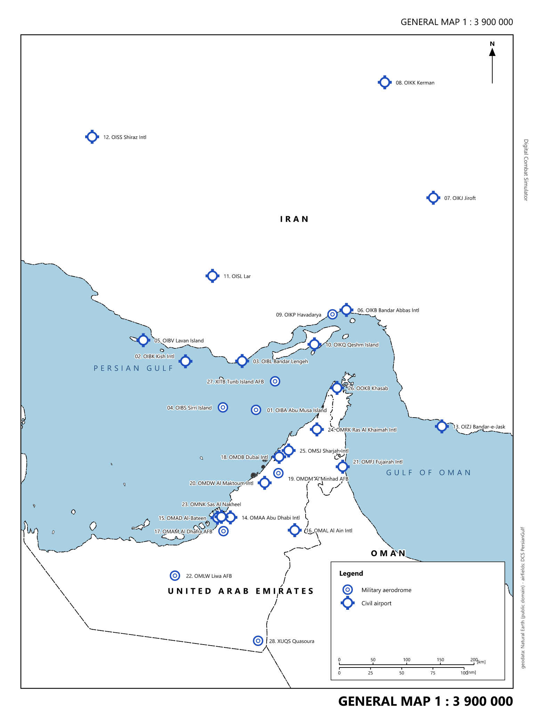
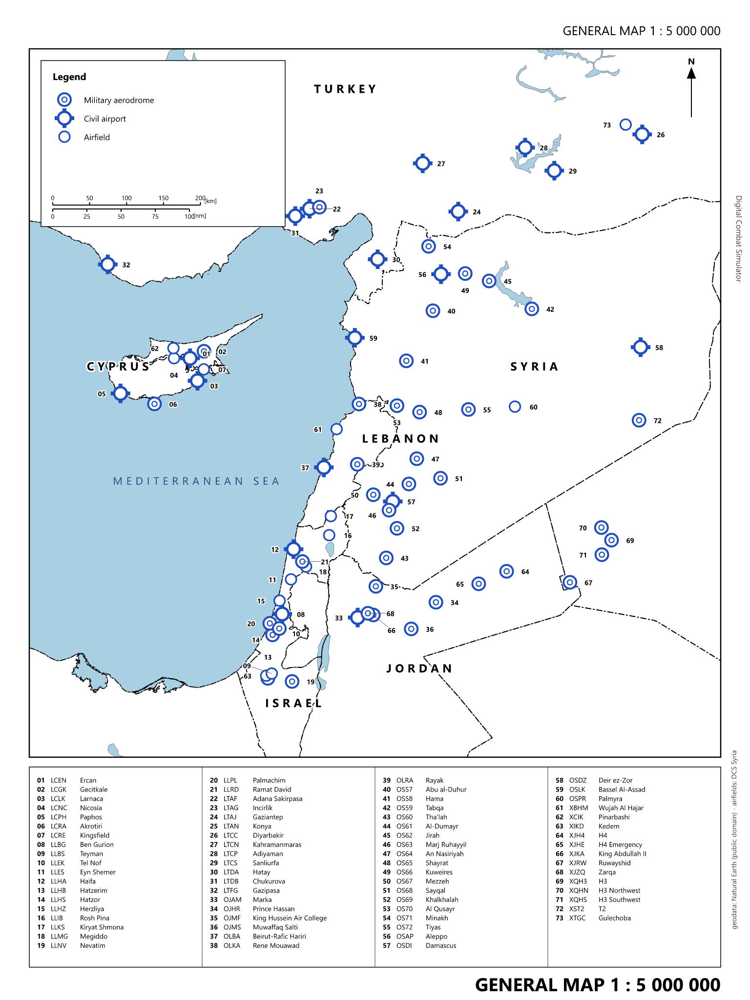

# DCS Aerodrome Charts

**English** | [Deutsch](README.de.md)

Aerodrome charts (GND) and parking position charts (PAR) for the airfields of the DCS World maps, in the style of the official DCS charts. Each map has its own folder with PNG and SVG files, an overview map and tables of all airfields.

> Unofficial charts, not made by Eagle Dynamics. For simulation only, **not for real-world navigation**.

## Maps

| Map | Airfields | Sheets | Overview | Download |
|---|---|---|---|---|
| [Germany Cold War](GermanyColdWar/README.md) | 83 | 209 |  | [GermanyColdWar.zip](https://github.com/sivar2311/DCS-Aerodrome-Charts/releases/latest/download/GermanyColdWar.zip) |
| [Kola](Kola/README.md) | 33 | 80 |  | [Kola.zip](https://github.com/sivar2311/DCS-Aerodrome-Charts/releases/latest/download/Kola.zip) |
| [Persian Gulf](PersianGulf/README.md) | 28 | 73 |  | [PersianGulf.zip](https://github.com/sivar2311/DCS-Aerodrome-Charts/releases/latest/download/PersianGulf.zip) |
| [Syria](Syria/README.md) | 73 | 203 |  | [Syria.zip](https://github.com/sivar2311/DCS-Aerodrome-Charts/releases/latest/download/Syria.zip) |

## Changes

What changed in which map: [CHANGELOG.md](CHANGELOG.md), with details in the changelog of each map.

## Download

Each [release](https://github.com/sivar2311/DCS-Aerodrome-Charts/releases/latest) has one ZIP file per map with all PNG sheets, ready for the kneeboard. The SVG files are in the map folders of this repository.

## Found an error?

These charts are generated automatically. Manual edits to the chart files would be overwritten by the next run, so please report errors as an [issue](https://github.com/sivar2311/DCS-Aerodrome-Charts/issues/new/choose) instead: map, airfield, sheet and what is wrong, ideally with a screenshot. Corrections to the README texts are welcome as pull requests.

## License

The charts are licensed under [CC BY 4.0](https://creativecommons.org/licenses/by/4.0/) (© sivar2311, https://github.com/sivar2311/DCS-Aerodrome-Charts). This license covers only the author's own contribution; rights of third parties remain unaffected. DCS World is a trademark of Eagle Dynamics SA; this project is not affiliated with or endorsed by Eagle Dynamics. Overview maps based on [Natural Earth](https://www.naturalearthdata.com/) (public domain). For simulation use only, not for real-world navigation. Provided without warranty.
