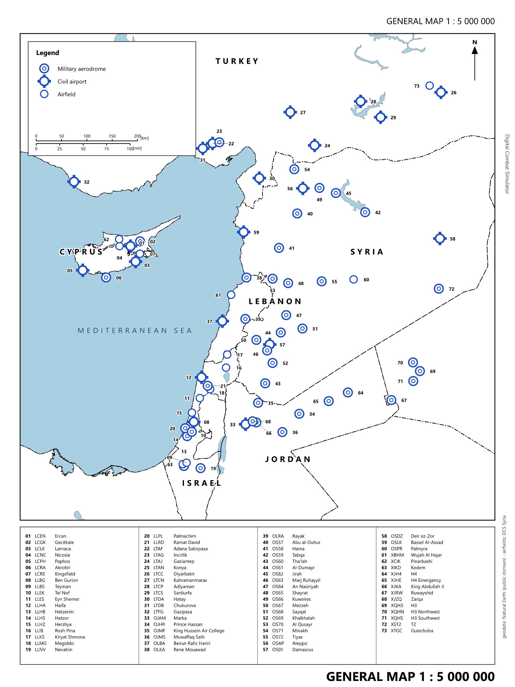

# Kneeboard-Karten für DCS: Syria

[← Alle Karten](../README.de.md)

[English](README.md) | **Deutsch**

Platzkarten (GND) und Parkpositionskarten (PAR) für alle Flugplätze mit befestigter Bahn ab 1000 m der DCS-Karte **Syria**, auch für die Plätze in der Türkei, im Libanon, in Israel, Jordanien, dem Irak und auf Zypern. Grasplätze sind nicht enthalten. Gestaltet sind die Karten nach dem Vorbild der offiziellen DCS-Karten für den Kaukasus.

> Inoffizielle Karten, nicht von Eagle Dynamics. Nur für die Simulation, **nicht für die reale Navigation**.

## Ordner

| Ordner | Inhalt |
|---|---|
| `png/` | Karten als Bild (1536 × 2048 Pixel), z. B. für das Kneeboard |
| `svg/` | Dieselben Karten als Vektorgrafik, verlustfrei skalierbar |

## Dateinamen

`NN_TYP_KENNUNG_Name[ - Zweitname][_Pn]`

| Teil | Bedeutung |
|---|---|
| `NN` | Nummer des Flugplatzes. Alle Plätze sind alphabetisch nach ihrer Kennung sortiert, wie bei den DCS-Karten. |
| `TYP` | `GND`: Platzkarte (Aerodrome Chart). `PAR`: Parkpositionen (Aircraft Parking Positions). |
| `KENNUNG` | ICAO-Code oder Ersatzkennung (siehe unten) |
| `Name` | Name des Platzes, wie er in DCS heißt |
| `Zweitname` | heutiger Name, falls er vom DCS-Namen abweicht, z. B. `Rene Mouawad - Kleyate` |
| `_Pn` | Blatt n, wenn ein Platz mehrere Blätter hat: P1 ist die Platzkarte, ab P2 kommen die Parkpositionen |

Oben auf jedem Blatt steht der Verweis für die Kartenmappe, z. B. `GND 59 · P2/6` (Bodenkarten, Platz 59, Blatt 2 von 6).

## Übersichtskarte

`00_01_General_Map` zeigt alle Flugplätze mit Nummer und Symbol. Darunter steht die Liste aller Plätze. Kartengrundlage ist Natural Earth (Public Domain).

## Kennungen

- **ICAO-Codes** für alle Plätze, die einen haben (`OS..` Syrien, `OL..` Libanon, `LL..` Israel, `OJ..` Jordanien, `LC..` Zypern, `LT..` Türkei).
- **`OSnn`** (z. B. `OS58` Hama): Syrische Militärflugplätze haben keinen ICAO-Code, nur eine nationale Ortskennung. Diese wird als Kennung verwendet.
- **`X…`**: Plätze ganz ohne bekannte Kennung bekommen eine **erfundene**: `X`, ein Länderbuchstabe (`S` Syrien, `B` Libanon, `I` Israel, `J` Jordanien, `Q` Irak, `C` Zypern, `T` Türkei) und zwei Buchstaben aus dem Namen, z. B. **XQH3** = H3 (Irak).

## Platzkarte (GND)

- Bahnen mit nutzbarer Länge (aus der Bahnbefeuerung in DCS) und Breite, Bahnbezeichnungen
- **Kurse magnetisch:** Die Missweisung ist für jeden Platz einzeln berechnet, mit dem Erdmagnetfeldmodell, das DCS selbst verwendet. Bezugsdatum ist der 1.6.2020, das Standarddatum einer neuen DCS-Mission auf dieser Karte. Der Nordpfeil zeigt rechtweisend Nord (TN), magnetisch Nord (MN) und die Missweisung, z. B. `VAR 5.0° E (2020)`. In Missionen mit anderem Datum weicht die Missweisung etwas ab.
- Rollwege mit Buchstaben (aus den Rollwegschildern in DCS)
- Haltepunkte `P1`, `P2` … mit Koordinaten (aus den Halteschildern), wie auf den DCS-Karten
- Tabellen: ILS, ARP, Platzhöhe, Maßstab, TORA/TODA/ASDA/LDA, Funkfrequenzen, Navigationsanlagen

## Parkpositionen (PAR)

- Jede Parkposition trägt **genau die Nummer, die DCS im Missionseditor anzeigt**. Startpositionen auf der Bahn sind nicht eingezeichnet.
- **Darstellung:** Jede Parkposition ist nur ihre Nummer, direkt an der Position. In Reihen steht sie quer zur Reihe, damit benachbarte Nummern nicht zusammenstoßen. Gibt DCS eine Nummer doppelt aus (ein Fehler in den DCS-Daten), steht sie auch auf der Karte doppelt.
- **Eignung:** Die Tabelle unten auf dem Blatt nennt für jede Ramp, geprüft am Missionseditor:
  - **AIRCRAFT:** alle Positionen, die Flugzeuge nutzen können, also normale Abstellflächen sowie Shelter und Hangars,
  - **HELICOPTER:** alle Positionen, die Hubschrauber nutzen können, also normale Abstellflächen und Hubschrauberplätze.

  Normale Abstellflächen eignen sich für beide und stehen deshalb in beiden Spalten.
- **Ramps:** Nah beieinander liegende Parkpositionen bilden eine Ramp. Benannt ist sie nach der Himmelsrichtung, in der sie von der Platzmitte aus liegt, z. B. `RAMP NORTH`.
  - Teilen sich mehrere Ramps eine Richtung, wird feiner unterschieden (`RAMP NORTH-EAST`) oder durchnummeriert (`RAMP WEST 1`, `RAMP WEST 2`).
  - Diese Namen sind **erfunden**, sie kommen in DCS selbst nicht vor. Sie sollen der Verständigung zwischen ATC und Piloten dienen, z. B. „taxi to ramp north, stand 21“.
- **Detailblätter:** Ist eine Ramp zu dicht für eine lesbare Beschriftung, bekommt sie ein vergrößertes Detailblatt. Die Übersicht verweist dann darauf („see P3“).
- Unten auf dem Blatt stehen eine Tabelle aller Ramps mit ihren Parkpositionen sowie Funk, ARP, Platzhöhe und Maßstab.

## Flugplätze

[Flugplätze nach Kennung](airfields_by_code.de.md) · [Flugplätze nach Name](airfields_by_name.de.md)

73 Flugplätze, 203 Blätter.

